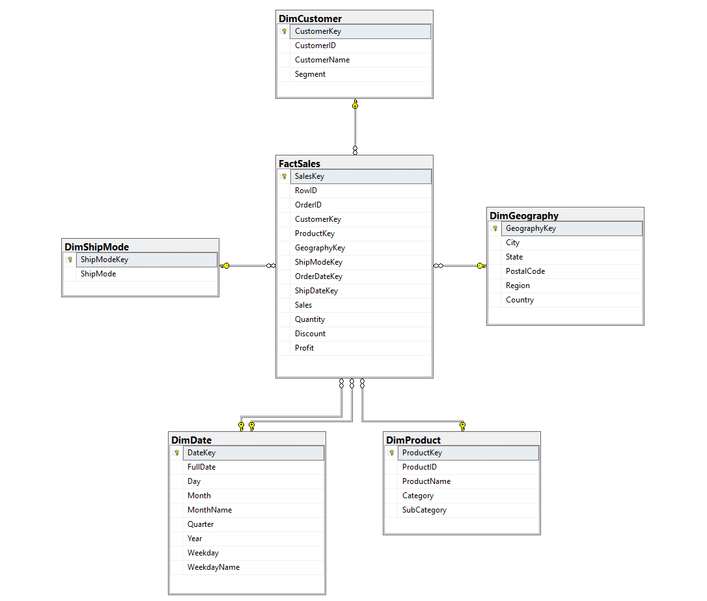
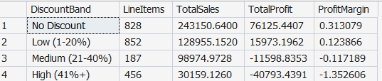
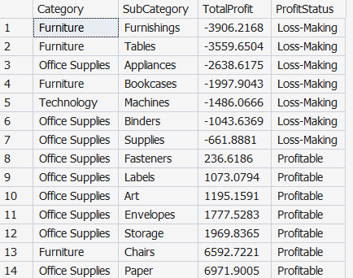
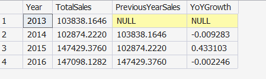
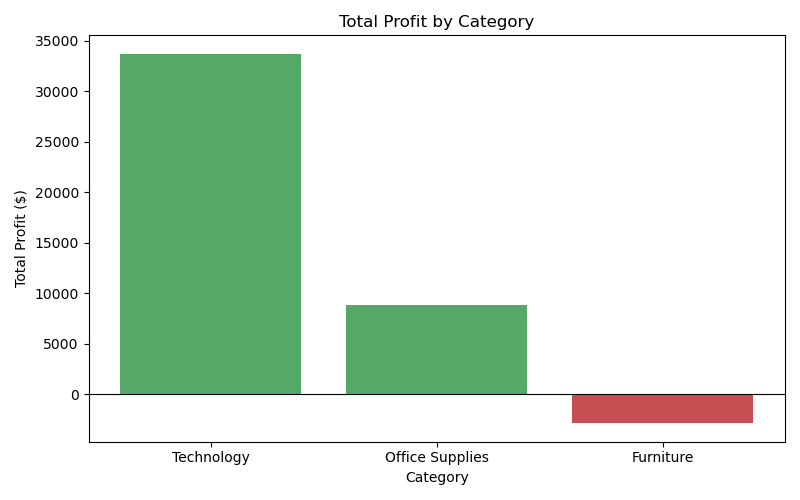
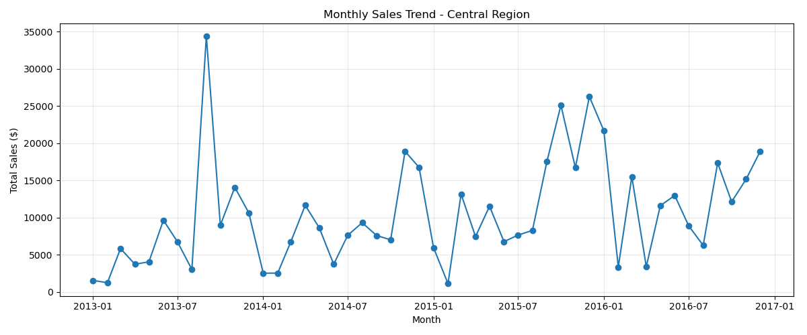

# Mini-Project 2 — Advanced SQL Data Warehouse & Business Analytics

**DEPI Submission** | Dataset: `Central_Superstore.xlsx` | Database: `DEPI_Superstore_DW`

---

## Project Preview

**Star Schema (SQL Server)**



**Discount level vs profit (Q19)** — heavy discounting turns profit negative



**Loss-making sub-categories (Q9)**



**Year-over-year sales growth (Q7, CTE)**



**Profit by category**



**Monthly sales trend**



More query screenshots are in [`outputs/query_results`](outputs/query_results) and charts in [`outputs/charts`](outputs/charts).

---

## 1. Project Title

Advanced SQL Data Warehouse & Business Analytics — Central Region Superstore

## 2. Business Scenario

A retail organization wants to transform its operational Superstore dataset
(the Central Region order-line extract) into an analytical relational
database for executive reporting and KPI monitoring. This project takes the
raw Excel export, cleans it, models it as a Star Schema in Microsoft SQL
Server, loads it through a Python/Jupyter ETL pipeline, and produces a full
set of analytical SQL queries, views, stored procedures, and KPI reports.

## 3. Objectives

- Normalize the flat Excel extract into dimension and fact tables (Star Schema)
- Enforce data integrity with primary/foreign keys, unique and check constraints
- Build a reusable, parameterized Python ETL pipeline (Excel → SQL Server)
- Deliver 20+ analytical SQL queries covering sales, profitability, customers, products, and shipping
- Deliver reusable SQL Views and Stored Procedures for KPI reporting
- Validate that no business measure (Sales/Profit) is lost during ETL
- Document performance optimization choices (indexing, surrogate keys, query patterns)

## 4. Dataset Description

- **File:** `data/Central_Superstore.xlsx`, sheet `Central_Region`
- **Rows:** 2,323 order-line records | **Columns:** 21
- **Grain:** one row per order line item (`Row ID`)
- **Date range:** Order Date 2013-01-03 to 2016-12-30; Ship Date up to 2017-01-05
- **Scope:** all records belong to Region = "Central", Country = "United States"
- **Key columns:** `Order ID`, `Customer ID`, `Product ID`, `Category`,
  `Sub-Category`, `Sales`, `Quantity`, `Discount`, `Profit`

No missing values or duplicate rows were found. See
[`docs/Data_Dictionary.md`](docs/Data_Dictionary.md) for the full list of
data-cleaning decisions (e.g. resolving 16 Product IDs that had two
conflicting Product Names in the source file).

## 5. Tools & Technologies

| Tool | Purpose |
|---|---|
| Microsoft SQL Server | Data warehouse engine |
| SQL Server Management Studio (SSMS) | Running SQL scripts, views, procedures |
| Anaconda / Jupyter Notebook | ETL pipeline & Python analysis environment |
| Python (pandas, numpy) | Data cleaning and transformation |
| SQLAlchemy + pyodbc | Connecting Python to SQL Server |
| matplotlib | Charts / visualizations |

## 6. Project Architecture

```
Central_Superstore.xlsx
        │
        ▼
 Python / Pandas (cleaning, star-schema DataFrames)
        │
        ▼
 SQLAlchemy + pyodbc  ──►  SQL Server: DEPI_Superstore_DW (Star Schema)
        │                          │
        │                          ├─ Views (KPI reporting)
        │                          ├─ Stored Procedures (parameterized reports)
        │                          └─ 21 analytical SQL queries
        ▼
 pd.read_sql() from Jupyter ──► KPI tables + 5 charts
```

## 7. Star Schema

5 dimension tables + 1 fact table. Full ERD (including a Mermaid diagram):
see [`docs/Star_Schema.md`](docs/Star_Schema.md).

- `DimDate` (role-playing: Order Date & Ship Date)
- `DimCustomer`
- `DimProduct`
- `DimGeography`
- `DimShipMode`
- `FactSales` (measures: Sales, Quantity, Discount, Profit)

## 8. ETL Workflow

Implemented in `notebooks/Mini_Project_2_ETL_Analysis.ipynb`:

1. Load `Central_Superstore.xlsx` with pandas
2. Inspect: shape, dtypes, missing values, duplicates, candidate keys
3. Clean: trim whitespace, resolve Product ID/Name conflicts, validate
   numeric ranges and date logic
4. Build one DataFrame per dimension + the fact table (surrogate keys assigned)
5. Validate zero Sales/Profit loss vs. the original Excel totals
6. Connect to SQL Server via SQLAlchemy + pyodbc
7. Load DataFrames into SQL Server with `to_sql()` (dimensions first, fact last)
8. Verify loaded row counts
9. Query SQL Server **back** into pandas with `pd.read_sql()` for analysis
10. Produce 5 charts and an executive KPI summary

## 9. Database Tables

| Table | Type | Rows |
|---|---|---|
| DimDate | Dimension | 1,058 |
| DimCustomer | Dimension | 629 |
| DimProduct | Dimension | 1,310 |
| DimGeography | Dimension | 195 |
| DimShipMode | Dimension | 4 |
| FactSales | Fact | 2,323 |

Full column-level detail: [`docs/Data_Dictionary.md`](docs/Data_Dictionary.md).

## 10. SQL Techniques Used

- **JOINs**: multi-table joins in nearly every query (`sql/05_analytical_queries.sql`)
- **Subqueries**: Q15 (customers above average), Q18 (products above average)
- **CTEs**: Q7 (YoY growth), Q16 (customer segmentation)
- **CASE statements**: Q9, Q12, Q16, Q19, Q21
- **Window functions**: `LAG()` for YoY growth (Q7), `RANK()` for product ranking (Q10)
- **Views**: `vw_SalesSummary`, `vw_CustomerPerformance`
- **Stored Procedures**: `usp_GetSalesByYear(@Year)`, `usp_GetRegionPerformance(@Region)`

## 11. KPI Definitions

| KPI | Formula |
|---|---|
| Total Sales | `SUM(Sales)` |
| Total Profit | `SUM(Profit)` |
| Profit Margin % | `SUM(Profit) / SUM(Sales)` |
| Total Orders | `COUNT(DISTINCT OrderID)` |
| Total Customers | `COUNT(DISTINCT CustomerKey)` |
| Total Quantity Sold | `SUM(Quantity)` |
| Average Order Value | `SUM(Sales) / COUNT(DISTINCT OrderID)` |
| Average Sales per Customer | `SUM(Sales) / COUNT(DISTINCT CustomerKey)` |
| Average Profit per Order | `SUM(Profit) / COUNT(DISTINCT OrderID)` |
| YoY Sales Growth | `(ThisYearSales - LastYearSales) / LastYearSales` |
| YoY Profit Growth | `(ThisYearProfit - LastYearProfit) / LastYearProfit` |

## 12. Analytical Reports

21 numbered queries in `sql/05_analytical_queries.sql`, grouped into:
Sales Analysis (Q1–Q7), Profitability (Q8–Q12), Customer Behavior (Q13–Q16),
Product Analysis (Q17–Q19), and Order/Shipping Analysis (Q20–Q21).

## 13. Performance Optimization

See `sql/06_indexes_optimization.sql` for full detail. Summary:

- Nonclustered indexes on every `FactSales` foreign key column
- An index on `DimDate(Year)` for year-based filtering and grouping
- Explanation of clustered vs nonclustered indexes
- `SET STATISTICS IO/TIME ON` demonstration
- A worked "before vs after" example showing why filtering on a stored,
  indexed `Year` column beats calling `YEAR(FullDate)` in a `WHERE` clause
- Explanation of why integer surrogate keys and a star schema shape improve
  join and aggregation performance

## 14. Data Validation

`sql/07_validation_queries.sql` checks: dimension/fact row counts, NULL
foreign keys, orphan foreign keys, duplicate business keys, and reconciles
`SUM(Sales)`/`SUM(Profit)` in `FactSales` against the original Excel totals
(**Total Sales = 501,239.89**, **Total Profit = 39,706.36** — both match
exactly, confirming zero measure loss during ETL).

## 15. How to Run This Project

1. **Create the database and schema** — open SSMS, connect to your SQL Server
   instance, and run in order:
   - `sql/01_create_database.sql`
   - `sql/02_create_star_schema.sql`
   - `sql/03_views.sql`
   - `sql/04_stored_procedures.sql`
   - `sql/06_indexes_optimization.sql`
2. **Run the ETL notebook** — open `notebooks/Mini_Project_2_ETL_Analysis.ipynb`
   in Jupyter (via Anaconda) and run all cells top to bottom. The SQL Server
   instance name is already configured (see Section 19), so no edit is
   needed. This loads all 6 tables into SQL Server and produces 5 charts +
   a KPI summary.
3. **Run the analytical queries** — open `sql/05_analytical_queries.sql` in
   SSMS and run any/all of the 21 queries.
4. **Run the validation queries** — open `sql/07_validation_queries.sql` in
   SSMS to confirm data integrity.

## 16. Requirements / Dependencies

See [`requirements.txt`](requirements.txt). Install with:
```
pip install -r requirements.txt
```
You also need an ODBC driver for SQL Server installed on your machine
(ODBC Driver 17 or 18 for SQL Server) — this is a system-level driver, not a
Python package.

## 17. Expected Outputs

- A populated `DEPI_Superstore_DW` database (6 tables, 2 views, 2 stored procedures, 6 indexes)
- `outputs/charts/` — 5 PNG charts (Monthly Sales Trend, Sales by Category,
  Profit by Category, Top 10 Customers, Sales vs Profit)
- `data/cleaned_superstore.csv` — the cleaned flat-file audit trail
- Console/notebook output confirming row counts and validation results

## 18. Key Business Insights (from the actual dataset)

- **Total Sales: $501,239.89** | **Total Profit: $39,706.36** | **Overall Profit Margin: 7.92%**
- 1,175 distinct orders across 629 customers; average order value **$426.59**
- **Technology** is both the top revenue category ($170,416) and by far the
  most profitable ($33,697 profit, ~19.8% margin)
- **Furniture is a net loss category overall** (–$2,871 profit on $163,797 in
  sales), dragged down primarily by the **Furnishings** and **Tables**
  sub-categories, which are the two biggest loss-makers in the entire dataset
- 7 of the 17 sub-categories are loss-making overall: Furnishings, Tables,
  Appliances, Bookcases, Machines, Binders, and Supplies
- **Discounting is strongly associated with losses**: line items with no
  discount have a 31.3% profit margin, while items discounted 41%+ have
  a –135.3% margin and account for –$40,793 in total profit — the single
  biggest driver of losses in the dataset
- **Texas** is the top state by sales ($170,188) but is also the **most
  unprofitable state overall** (–$25,729 profit), followed by Illinois
  (–$12,608) — both likely driven by the same heavy-discounting pattern
- Sales grew from ~$103.8K (2013) to ~$147.1K (2016), a meaningful
  multi-year upward trend with a step-change increase starting in 2015
- Top customer by total sales is **Tamara Chand** ($18,437)
- **Same Day** shipping (as expected) has the shortest average shipping time
  (~0.03 days), while **Standard Class** — the most-used mode (1,439 of 2,323
  line items) — averages ~5.0 days

## 19. SQL Server Instance Name

Section 5 of `notebooks/Mini_Project_2_ETL_Analysis.ipynb` connects using:

```python
SERVER_NAME = "Fatima_Awad"
```

This is the value returned by running `SELECT @@SERVERNAME;` in SSMS on this
machine.

## 20. Conclusion

`Central_Superstore.xlsx` was transformed into a fully normalized, indexed,
constraint-enforced Star Schema data warehouse in SQL Server, loaded through
a reproducible Python/Jupyter ETL pipeline, and analyzed with 21 SQL queries,
2 views, and 2 stored procedures — with every business measure validated to
reconcile exactly against the original source file. See
[`docs/Project_Report.md`](docs/Project_Report.md) for the full narrative
write-up and [`docs/Final_Checklist.md`](docs/Final_Checklist.md) for a
requirement-by-requirement completion checklist.
