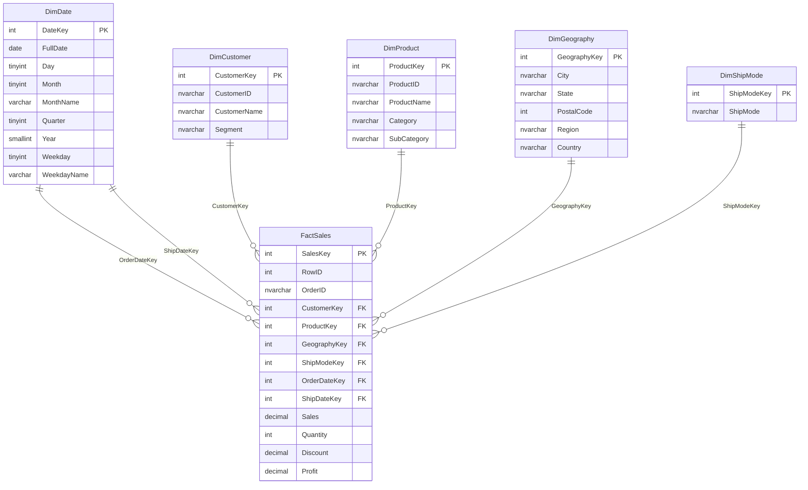

# Star Schema — DEPI_Superstore_DW

## Textual Diagram

```
                         DimCustomer
                              |
                              |
    DimShipMode ------- FactSales ------- DimProduct
                          |      |
                          |      |
                    DimDate   DimGeography
                 (Order Date &
                    Ship Date,
                  role-playing)
```

`FactSales` sits at the center and connects to every dimension through a
surrogate integer foreign key. `DimDate` is used twice — once for
`OrderDateKey` and once for `ShipDateKey` — a standard "role-playing
dimension" pattern, so there is only one calendar table to maintain.

## Mermaid ER Diagram



## Why a Star Schema

- **Query performance**: analytical queries filter/group on small dimension
  tables (e.g. `Category`, `Region`, `Year`) and aggregate measures from one
  large fact table — the optimizer can filter dimensions first and join to
  the fact table using indexed integer keys.
- **Simplicity**: one join "hop" from fact to any dimension, which keeps SQL
  readable and BI-tool-friendly (Power BI, Tableau, Excel PivotTables all
  work naturally against a star schema).
- **Surrogate keys**: `INT` surrogate keys are smaller and faster to join on
  than the original string business keys (`Customer ID`, `Product ID`), and
  they insulate the warehouse from changes to source-system identifiers.
